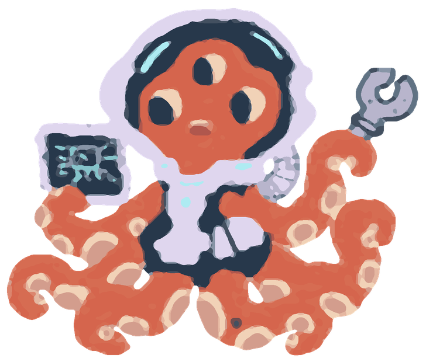

  

<h1 align="center">AQUANAUTS</h1>

<b>Small crew. Giant discoveries.</b> 
An astronaut training mission for kids ages 7 to 12, run by a crew of sea creatures.

  <a href="https://aquanauts.app">aquanauts.app</a>

---

Aquanauts is an interactive astronaut training experience designed to help children understand what it takes to operate a lunar base. Rather than presenting space science through traditional lessons, our game places players inside a simulated environment where they can experience the responsibilities of an astronaut firsthand.

## How Aquanauts Works

Players explore a three-dimensional lunar base using keyboard or touchscreen controls. Throughout eight missions, they work alongside a crew of sea-creature astronauts, each specializing in an essential part of the base's operations. Every mission introduces a scientific concept through a short lesson before challenging players to apply what they have learned.

| Mission | Crew member | Specialty |
|---|---|---|
| 01 | Bloop | Life support |
| 02 | Moss | Energy systems |
| 03 | Nori | Food and agriculture |
| 04 | Luma | Space hazards |
| 05 | Pip | Engineering |
| 06 | Skim | Sustainability |
| 07 | Pebble | Mission planning |
| 08 | Tank | Final mission |

For example, players might discover that the base's air filtration system has malfunctioned. They must locate the appropriate tools, navigate to the affected equipment, and complete repairs to restore the system. Other missions explore how astronauts generate electricity, produce food, protect themselves from radiation, and manage limited resources. These activities demonstrate how individual systems contribute to the success of an entire mission.

To make the experience approachable for younger audiences, crew members guide players through captioned instructions, while a glowing navigation trail helps them locate their next objective. Each mission concludes with a knowledge check that reinforces the scientific principles introduced during gameplay.

Beyond the simulation, Aquanauts includes a connected website that serves as the player's mission control center. Children can monitor their progress, explore a map of the lunar base, and earn coins to unlock rewards. They can also adopt interactive 3D crew pets, encouraging continued engagement as they advance through the game. A dedicated teacher mode allows educators to access individual missions directly, making Aquanauts adaptable for classroom instruction.

We also designed and built a physical Aquanauts game board that connects to the game to introduce an additional hands-on element. The board features five illuminated LEDs and three rotating dials, with a spinning octopus head as its centerpiece. This extension allows children to interact with the Aquanauts theme beyond the digital environment.

## Educational Benefits and Intended Impact

Our primary goal is to help children understand the reasoning behind the systems that make space exploration possible. Instead of memorizing facts about spacecraft, players discover why those systems matter by experiencing situations in which they are needed.

Aquanauts also encourages independent learning. Players can repeat missions without penalties, allowing them to experiment with different approaches and learn from their mistakes. We intentionally avoided traditional time limits and failure-based mechanics so that children can focus on understanding concepts rather than simply completing tasks.

We hope Aquanauts inspires children to recognize the variety of careers involved in space exploration. A successful mission depends on far more than astronauts alone, and our lessons demonstrate how different scientific disciplines contribute to a shared objective. By introducing these responsibilities at an early age, we want children to begin imagining themselves as future contributors to space exploration.

## Development Tools and Technology

We developed the Aquanauts website using HTML, CSS, and JavaScript. The three-dimensional simulation was built with Three.js and Vite, allowing players to explore an interactive lunar environment directly in their browsers. Firebase Authentication and Firestore support optional user accounts and progress tracking, while GitHub Pages hosts the application, which is also embedded within our WordPress website.

During development, we used Claude, an AI assistant developed by Anthropic, to support coding and testing. Canva was used to design our presentation materials, and we used Procreate to make all of our characters. AI-generated images helped us visualize potential merchandise. These images are clearly labeled.

## Creativity and Design Considerations

One of Aquanauts' most distinctive features is its unusual approach to astronaut training. Rather than using conventional human astronauts, we created a crew of sea creatures, each with a recognizable personality and responsibility aboard the lunar base. This creative direction makes an unfamiliar scientific environment feel welcoming to younger children without removing the complexity of the concepts being taught.

We also wanted the gameplay to reflect authentic challenges rather than unrelated educational activities. NASA resources, including DONKI space weather observations and OSDR astronaut health research, helped inform our mission design. Measurements from lunar and Martian exploration provided additional scientific context, allowing us to connect fictional scenarios with real discoveries.

Accessibility was another major consideration. Aquanauts runs in a web browser without requiring a download, and children can begin playing as guests without creating an account. Caption-based guidance supports use in classrooms and quiet environments, while adjustable text sizes, reduced-motion options, and simplified gameplay help accommodate different needs.

Throughout development, we focused on creating an experience that children would genuinely enjoy while ensuring that the science remained meaningful. Every design decision was guided by the same goal: helping young learners move beyond simply knowing facts about space to understanding how those facts apply to real missions.

Ultimately, Aquanauts demonstrates that meaningful STEM education does not have to feel like a traditional classroom lesson. By allowing children to take responsibility for their own lunar mission, we hope to inspire the confidence and curiosity that will encourage them to continue exploring STEM long after the game ends.
